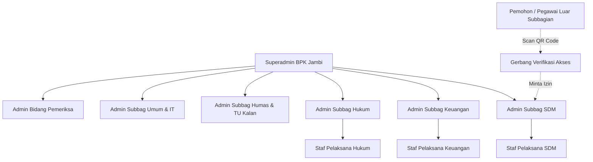

# MATERI LENGKAP PRESENTASI & DESKRIPSI SISTEM SIKANTI
## SISTEM INFORMASI KATALOG ARSIP DAN NASKAH TERINTEGRASI
### BPK PERWAKILAN PROVINSI JAMBI

---

> **Petunjuk untuk NotebookLM:**
> Dokumen ini adalah naskah rujukan komprehensif (Master Source Document) mengenai aplikasi **SIKANTI**. Naskah ini disusun secara runtut mencakup profil aplikasi, latar belakang permasalahan, tujuan strategis, arsitektur pengguna, fitur utama, alur kerja (workflow) end-to-end, studi komparasi before-after, hingga rancangan slide presentasi PowerPoint (slide deck outline) lengkap dengan narasi pembicara (*speaker notes*).

---

## 1. EXECUTIVE SUMMARY & IDENTITAS APLIKASI

* **Nama Aplikasi:** SIKANTI (Sistem Informasi Katalog Arsip dan Naskah TerIntegrasi)
* **Instansi Pengguna:** Badan Pemeriksa Keuangan Perwakilan Provinsi Jambi
* **Klasifikasi Sistem:** Sistem Tata Kelola Kearsipan Digital, Katalogisasi Naskah, dan Kontrol Sirkulasi Dokumen Berbasis Web & QR Code
* **Tahun Pengembangan:** 2026
* **Pengembang:** Farhan
* **Platform:** Web Responsive (Dapat diakses secara optimal melalui Desktop, Laptop, Tablet, dan Smartphone tanpa perlu instalasi aplikasi tambahan)
* **Tagline:** *"Mewujudkan Tata Kelola Kearsipan BPK yang Akuntabel, Cepat, Terisolasi Aman, dan Terintegrasi"*

### Visi Utama SIKANTI:
Mentransformasikan tata kelola ordner dan naskah dinas fisik di lingkungan BPK Perwakilan Provinsi Jambi menjadi sistem digital yang aman, terlacak secara real-time, memenuhi kaidah Jadwal Retensi Arsip (JRA) resmi, dan mencegah kebocoran informasi rahasia antar-subbagian.

---

## 2. LATAR BELAKANG & URGENSI IMPLEMENTASI DI BPK JAMBI

### A. Tantangan Tata Kelola Kearsipan Konvensional
1. **Penumpukan Berkas Fisik & Keterbatasan Ruang:** Ribuan ordner berkas pemeriksaan, administrasi keuangan, kepegawaian, dan naskah hukum menumpuk di lemari/ruang arsip, memakan tempat dan berisiko mengalami kerusakan fisik akibat kelembapan atau bencana.
2. **Lambatnya Waktu Temu Kembali (*Retrieval Time*):** Pencarian dokumen fisik yang disimpan bertahun-tahun membutuhkan waktu puluhan menit hingga berjam-jam saat dibutuhkan mendadak untuk keperluan pemeriksaan atau tindak lanjut audit.
3. **Pencatatan Peminjaman yang Manual & Rentan Kehilangan:** Sirkulasi berkas yang dipinjam lintas subbagian masih dicatat di buku agenda atau bahkan tidak terdokumentasi rapi, sehingga sering terjadi berkas terselip, rusak, atau sulit ditelusuri siapa penanggung jawab peminjamnya.
4. **Kesulitan Pemantauan Jadwal Retensi Arsip (JRA):** Mengetahui dokumen mana yang masa retensinya masih *Aktif*, mana yang sudah *Inaktif*, dan kapan sebuah berkas harus *Dimusnahkan* atau *Dipermanenkan* sangat sulit dilakukan jika mengandalkan rekap manual.
5. **Risiko Akses Tanpa Izin (*Data Breach*):** Naskah dinas dan berkas pemeriksaan memuat data berklasifikasi rahasia. Tanpa sistem gerbang akses digital, dokumen fisik mudah dibaca oleh pihak yang tidak berhak.

### B. Urgensi bagi BPK Perwakilan Provinsi Jambi
* Memberikan kepastian posisi fisik dokumen melalui kodifikasi cerdas (QR Code) yang ditempel langsung pada ordner / map fisik.
* Menyediakan jaminan integritas bahwa tidak ada satupun dokumen rahasia subbagian yang dapat diakses oleh pihak luar tanpa persetujuan resmi dari Administrator subbagian pemilik berkas.

---

## 3. ARSITEKTUR KEAMANAN & HAK AKSES PENGGUNA (ROLE HIERARCHY)

SIKANTI mengadopsi prinsip **Role-Based Access Control (RBAC)** dengan arsitektur **Database Isolation** dan **UI Isolation** yang ketat, serta mekanisme **Closed-Loop Registration** (pendaftaran tertutup tanpa registrasi publik).



### 1. Superadmin (Tingkat Instansi / Pimpinan BPK)
* **Kewenangan Global:** Memiliki wewenang pemantauan tingkat makro di seluruh perwakilan.
* **Dashboard Makro:** Memantau grafik statistik real-time "Volume Dokumen per Subbagian", total arsip se-kantor, dan rasio status retensi berkas (Aktif, Inaktif, Selesai).
* **Pengaturan Sistem Terpusat:** Mengonfigurasi identitas lembaga (nama instansi, logo resmi BPK, slogan).
* **Manajemen Master Subbagian & Kode Klasifikasi:** Mengelola struktur organisasi subbagian (SDM/KP, Keuangan/KU, Hukum/HK, Humas dan TU Kalan/HM, Umum & IT/UM, Pemeriksa/PM).
* **Manajemen Pengguna Terpusat:** Mendaftarkan dan mengelola akun Administrator untuk tiap-tiap subbagian.

### 2. Admin Subbagian (Kepala / Penanggung Jawab Kearsipan Unit)
* **Isolasi Database Penuh:** Hanya dapat mengakses, melihat, dan mengelola dokumen yang menjadi wewenang subbagiannya.
* **Manajemen Gudang Klasifikasi:** Menata direktori folder berdasarkan nomenklatur resmi kearsipan (misal: KP.00, KP.01, dsb.).
* **Registrasi & Pengelolaan Arsip:** Mengunggah file naskah (PDF/Doc/Scan), mengisi nomor dokumen, tahun, masa simpan, dan menetapkan metadata JRA.
* **Pemberian Izin Akses Real-Time:** Menjadi garda depan persetujuan (*approval gatekeeper*) ketika ada pegawai luar yang memindai QR Code untuk meminjam atau membaca arsip unitnya.
* **Manajemen Akun Staf (Closed-Loop):** Mendaftarkan akun staf pelaksana di bawah unitnya secara mandiri.
* **Pengawasan Jejak Aktivitas (Audit Trail):** Memantau histori log operasional dari seluruh anggota tim di subbagiannya.
* **Pengelolaan Tempat Sampah (Recycle Bin):** Memulihkan dokumen yang tidak sengaja terhapus (*restore*) atau memusnahkan secara permanen (*hard delete*) sesuai kaidah JRA.
* **Ekspor Rekapitulasi:** Mengunduh buku daftar arsip resmi dalam format Microsoft Excel dan dokumen PDF cetak.

### 3. Staf Pelaksana Subbagian
* **Akses Operasional Terarah (UI Isolation):** Antarmuka disederhanakan secara otomatis oleh sistem. Staf hanya melihat menu *Dashboard* dan *Gudang Folder*. Menu konfigurasi sensitif (Pengaturan, Jejak Aktivitas, Kelola Sampah, Tim) disembunyikan.
* **Fokus Kerja Harian:** Melakukan pencarian naskah digital, mengunggah naskah baru ke dalam folder yang telah disediakan oleh Admin, dan membaca dokumen internal.
* **Proteksi Integritas Data:** Staf tidak dapat menghapus berkas secara permanen atau mematikan fitur audit trail.

### 4. Pemohon / Peminjam Eksternal (Lintas Subbagian)
* **Tanpa Perlu Akun Login:** Pegawai dari subbagian lain yang ingin meminjam berkas fisik atau melihat naskah digital cukup memindai stiker QR Code yang tertera pada ordner fisik menggunakan kamera HP.
* **Pengisian Tiket Permohonan:** Mengisi formulir identitas: Nama Lengkap, Asal Subbagian, dan Alasan/Tujuan Akses.
* **Menunggu Otorisasi:** Akses dokumen tetap terkunci sampai Admin pemilik arsip menyetujui permohonan tersebut secara online.

---

## 4. FITUR-FITUR UNGGULAN APLIKASI (KEY FEATURES)

### 1. Smart Dashboard & Statistik Real-Time
* Visualisasi grafik area interaktif yang menampilkan volume persebaran arsip (per folder untuk Admin Subbag, atau per subbagian untuk Superadmin).
* Widget penghitung otomatis status dokumen berdasarkan ketentuan Jadwal Retensi Arsip (Arsip Aktif, Arsip Inaktif, dan Arsip Selesai/Penyusutan).
* Kartu aktivitas mutakhir yang mencatat peristiwa operasional terbaru secara kronologis.

### 2. Gudang Klasifikasi & Brankas Folder Dinamis
* Struktur direktori folder virtual tanpa batas (*unlimited categories*) yang disesuaikan dengan skema penomoran nomenklatur BPK.
* Setiap folder memuat statistik kapasitas berkas di dalamnya, tanggal pembaruan, dan subbagian pemilik.

### 3. Otomatisasi Jadwal Retensi Arsip (JRA Engine)
* Sistem secara cerdas menghitung masa kedaluwarsa dokumen berdasarkan tahun pembuatan dan lama retensi aktif-inaktif.
* Pengkategorian otomatis status hukum arsip:
  * **Aktif:** Masih sering digunakan dalam operasional kerja harian.
  * **Inaktif:** Frekuensi penggunaan menurun, disimpan di ruang transit arsip.
  * **Musnah:** Telah habis masa retensi dan layak dimusnahkan secara hukum.
  * **Permanen:** Berkas bersejarah/vital yang wajib disimpan selamanya oleh negara.

### 4. Gerbang Keamanan QR Code & Sirkulasi Real-Time
* Setiap berkas yang didaftarkan ke sistem otomatis memiliki QR Code unik beresolusi tinggi yang dapat langsung dicetak (*print label*) dan ditempel pada map/ordner fisik.
* Menghubungkan dunia fisik dengan dunia digital secara instan.
* Ketika QR Code dipindai oleh pemohon, notifikasi antrean merah muncul seketika di dashboard Admin pemilik dokumen.
* **Persetujuan Bertingkat:** Admin dapat memilih memberikan izin:
  * **Hak Tinjau Saja (*View Only*):** Pemohon hanya dapat membaca di layar HP tanpa tombol unduh.
  * **Hak Unduh Penuh (*Allow Download*):** Pemohon diperkenankan mengunduh salinan file digital.
  * **Tolak Permohonan:** Admin wajib menyertakan alasan penolakan (misal: "Dokumen berstatus rahasia pemeriksaan").

### 5. Smart In-Browser Document Viewer (PDF.js)
* Membuka dokumen digital secara mulus langsung di dalam browser tanpa memaksa pengunduhan file ke memori perangkat lokal pengguna.
* Mencegah tercecer atau tersebarnya salinan naskah rahasia di galeri atau folder unduhan HP pengguna.

### 6. Rekapitulasi Eksekutif (Ekspor Excel & PDF)
* Menyediakan fitur cetak laporan inventaris berkas dalam format Microsoft Excel (.xlsx) dengan tata letak sel profesional.
* Format PDF siap cetak berstandar kedinasan lengkap dengan kopsurat instansi, nomor kode klasifikasi, deskripsi, lokasi ordner, dan lembar pengesahan.

### 7. Jejak Aktivitas (Audit Trail) & Auto-Retention Policy
* Rekaman jejak audit forensik digital (*who does what, and when*): mencatat setiap aktivitas login, pembuatan folder, registrasi berkas, pembacaan, pengubahan data, verifikasi peminjaman, hingga penghapusan.
* Dilengkapi pembersihan otomatis berkala setelah 30 hari untuk menjaga performa database tetap ringan dan optimal.

### 8. Brankas Pemulihan (*Recycle Bin / Soft Deletes*)
* Penghapusan dokumen tidak langsung menghilangkan data dari server, melainkan dipindahkan ke Brankas Sampah.
* Melindungi instansi dari risiko kelalaian manusia (*human error*) atau tindakan penghapusan berkas yang tidak disengaja.

---

## 5. ALUR KERJA SISTEM (END-TO-END BUSINESS PROCESS WORKFLOW)

```
[DOKUMEN FISIK TIBA]
       │
       ▼
[REGISTRASI ARSIP] ──────────► [UPLOAD FILE DIGITAL & ISI JRA]
       │                                     │
       ▼                                     ▼
[CETAK STIKER QR CODE]               [MASUK GUDANG FOLDER DIGITAL]
       │                                     │
       ▼                                     │
[TEMPEL DI ORDNER FISIK]                     │
       │                                     │
       ├─────────────────────────────────────┘
       │
       ▼
[PEGAWAI LAIN MEMBUTUHKAN ARSIP]
       │
       ▼
[SCAN QR CODE DENGAN HP]
       │
       ▼
[ISI FORM: NAMA, SUBBAG, TUJUAN] ────► [NOTIFIKASI REAL-TIME KE ADMIN]
                                                     │
                                                     ▼
                                      [ADMIN REVIEW PERMOHONAN]
                                       ├──► [TOLAK: Beri Alasan]
                                       └──► [SETUJUI: View-Only / Download]
                                                     │
                                                     ▼
                                      [PEMOHON BACA DOKUMEN DI HP]
```

### Rincian 4 Alur Utama:

#### Alur 1: Registrasi dan Pelabelan QR Code
1. Staf/Admin menerima naskah dinas atau berkas pemeriksaan fisik.
2. Membuka menu **Gudang Folder** SIKANTI, memilih folder klasifikasi yang sesuai.
3. Klik **Registrasi Arsip**, unggah file pindaian (PDF), isi nomor dokumen, uraian, tahun, masa aktif, dan status JRA.
4. Klik simpan. Sistem membuat data digital dan mengenerate **QR Code** unik.
5. Admin mengklik ikon cetak QR, mencetak stiker kode, dan menempelkannya pada punggung ordner fisik di lemari arsip.

#### Alur 2: Pencarian Cepat (*Retrieval*)
1. Ketika pimpinan atau pegawai memerlukan arsip tertentu, buka SIKANTI.
2. Gunakan kolom pencarian cerdas berdasarkan kata kunci judul, nomor berkas, tahun, atau kategori.
3. Dokumen ditemukan dalam waktu kurang dari 3 detik lengkap dengan informasi ordner penyimpanan dan pratinjau digitalnya.

#### Alur 3: Sirkulasi & Peminjaman Lintas Unit (Gerbang QR)
1. Pegawai peminjam mendatangi ruang arsip dan menemukan ordner fisik berstiker QR SIKANTI.
2. Peminjam memindai QR Code menggunakan kamera smartphone.
3. Muncul halaman formulir verifikasi: peminjam mengisi nama, asal subbagian, dan tujuan peminjaman.
4. Di dashboard Admin pemilik arsip, muncul notifikasi lencana permohonan akses baru.
5. Admin memeriksa alasan peminjaman:
   - Jika diizinkan: Admin mengklik **Setujui (Bisa Tinjau)** atau **Setujui (Bisa Unduh)**.
   - Layar smartphone peminjam seketika terbuka dan menampilkan dokumen yang dipinjam.
   - Seluruh riwayat peminjaman tercatat abadi di log audit sistem.

#### Alur 4: Pemantauan Retensi & Penyusutan Arsip
1. Admin memeriksa ringkasan widget di Dashboard.
2. Sistem menandai arsip yang telah berganti status dari Aktif menjadi Inaktif, atau Inaktif menjadi Musnah/Permanen.
3. Berkas yang berstatus "Musnah" dapat diproses sesuai berita acara pemusnahan resmi BPK, lalu dipindahkan ke brankas sampah untuk diaudit sebelum pembersihan total.

---

## 6. ANALISIS MANFAAT: SEBELUM vs SESUDAH MENGGUNAKAN SIKANTI

| Parameter Penilaian | Kondisi Sebelum SIKANTI (Konvensional) | Kondisi Sesudah SIKANTI (Digital Terintegrasi) |
| :--- | :--- | :--- |
| **Waktu Pencarian Berkas** | 15 menit hingga lebih dari 1 jam membongkar rak ordner fisik. | **Kurang dari 5 detik** melalui pencarian digital terindeks. |
| **Keamanan & Kerahasiaan** | Berkas fisik di ordner rentan dibuka oleh siapapun yang masuk ruangan. | **Akses Terisolasi & Terkunci**. Wajib verifikasi QR Code & persetujuan Admin pemilik. |
| **Sirkulasi Peminjaman** | Menggunakan buku ekspedisi manual, sering lupa dicatat, arsip hilang tanpa jejak. | **Tercatat Digital Real-Time**. Setiap akses terekam identitas peminjam, waktu, dan tujuan. |
| **Pengawasan Jadwal Retensi** | Sulit mengetahui usia dokumen; berkas kedaluwarsa menumpuk sia-sia. | **Kalkulasi Otomatis JRA**. Sistem memilah arsip Aktif, Inaktif, Musnah, dan Permanen secara otomatis. |
| **Aksesibilitas Mobile** | Dokumen hanya dapat diakses saat fisik ordner berada di depan mata. | **Fleksibel & Responsif**. Pratinjau berkas dapat dibuka aman melalui smartphone di mana saja dalam jaringan BPK. |
| **Pelaporan Manajemen** | Rekapitulasi berkas harus diketik manual satu per satu ke lembar Excel. | **Sekali Klik (One-Click Export)** ke format Microsoft Excel dan dokumen PDF berstandar. |
| **Perlindungan Data Hilang** | Jika berkas fisik terselip atau rusak, dokumen hilang permanen. | Salinan digital tersimpan di server aman dan dilengkapi **Brankas Pemulihan (Recycle Bin)**. |

---

## 7. RANCANGAN SLIDE PRESENTASI POWERPOINT (OUTLINE & TALKING POINTS)

Gunakan struktur di bawah ini saat menyusun slide presentasi PowerPoint untuk BPK:

### SLIDE 1: JUDUL & PEMBUKA
* **Judul Utama:** SIKANTI: Transformasi Tata Kelola Kearsipan Digital BPK RI Perwakilan Provinsi Jambi
* **Sub-Judul:** Sistem Informasi Katalog Arsip dan Naskah TerIntegrasi Berbasis Pengamanan QR Code & Jadwal Retensi Otomatis
* **Presenter:** Tim Pengembang / Bagian Terkait BPK Jambi
* **Poin Visual:** Logo resmi BPK RI berdampingan dengan logo SIKANTI beraksen Navy & Gold (#0f172a & #C8A35A).
* **Catatan Pembicara (*Speaker Notes*):**
  > *"Selamat pagi Bapak/Ibu Pimpinan dan Rekan-rekan BPK Perwakilan Provinsi Jambi. Hari ini kami bangga memperkenalkan SIKANTI, inovasi sistem kearsipan modern yang dirancang khusus untuk menjawab tantangan pengelolaan berkas fisik dan digital di lingkungan kerja BPK secara aman, tertib, dan akuntabel."*

---

### SLIDE 2: MENGAPA SIKANTI? (LATAR BELAKANG & TANTANGAN)
* **Poin Utama:**
  * Penumpukan ribuan ordner berkas fisik di ruang arsip.
  * Lamanya waktu pencarian dokumen saat dibutuhkan mendesak untuk audit.
  * Sirkulasi berkas keluar masuk yang belum terlacak secara ketat.
  * Kesulitan memantau kepatuhan masa retensi (JRA) berkas negara.
* **Poin Visual:** Ilustrasi perbandingan tumpukan ordner berdebu vs direktori digital yang bersih dan teratur.
* **Catatan Pembicara:**
  > *"Setiap tahunnya, volume berkas administrasi dan pemeriksaan di BPK Jambi terus bertambah. Cara kerja manual tidak lagi memadai untuk menjamin kecepatan temu kembali berkas dan keamanan kerahasiaan informasi negara."*

---

### SLIDE 3: PENGENALAN SIKANTI (SOLUSI STRATEGIS)
* **Poin Utama:**
  * Menjembatani ordner fisik di lemari dengan katalog dokumen digital di server.
  * Mengintegrasikan stiker QR Code pintar pada setiap fisik ordner.
  * Memenuhi regulasi Jadwal Retensi Arsip (JRA) pemerintah secara otomatis.
  * Menjamin isolasi data antar-subbagian tanpa celah kebocoran naskah.
* **Poin Visual:** Mockup antarmuka Dashboard SIKANTI di laptop dan smartphone.

---

### SLIDE 4: ARSITEKTUR PERAN PENGGUNA (MULTI-TIER SECURITY)
* **Poin Utama:**
  1. **Superadmin:** Pengawasan makro seluruh kantor, manajemen master subbagian, dan pengaturan instansi global.
  2. **Admin Subbagian (SDM, Keuangan, Hukum, Humas & TU Kalan, Umum & IT, Pemeriksa):** Penguasa penuh brankas arsip unit dan verifikator peminjaman.
  3. **Staf Pelaksana:** Entri berkas dan operasional harian terisolasi (*UI Isolation*).
  4. **Peminjam / Eksternal:** Akses terkunci via scan QR Code wajib izin admin.
* **Poin Visual:** Bagan hierarki peran pengguna dengan garis isolasi data.

---

### SLIDE 5: FITUR UTAMA 1 - GUDANG KLASIFIKASI & OTOMASI JRA
* **Poin Utama:**
  * Manajemen direktori folder tak terbatas berdasarkan nomenklatur BPK.
  * Perhitungan dinamis masa retensi arsip (Tahun Dokumen + Masa Aktif/Inaktif).
  * Status otomatis: **Aktif**, **Inaktif**, **Musnah**, atau **Permanen**.
  * Transparansi status retensi untuk mempermudah perencanaan penyusutan berkas tahunan.
* **Poin Visual:** Tangkapan layar tabel data arsip dengan badge status retensi berwarna-warni (Hijau untuk Aktif, Kuning untuk Inaktif, Merah untuk Musnah, Biru untuk Permanen).

---

### SLIDE 6: FITUR UTAMA 2 - GERBANG VERIFIKASI QR CODE REAL-TIME
* **Poin Utama:**
  * Solusi pengamanan fisik paling inovatif di SIKANTI.
  * Pemindaian stiker QR di ordner memicu pengisian tiket permohonan akses.
  * Notifikasi antrean merah muncul secara instan di layar Admin pemilik dokumen.
  * Otorisasi selektif: Admin dapat mengizinkan *View-Only*, memberi izin *Download*, atau menolak dengan alasan tertulis.
* **Poin Visual:** Alur ilustrasi: Scan Stiker QR di Ordner HP Pemohon Permohonan Terkirim Notifikasi di Layar Admin Dokumen Terbuka Aman.

---

### SLIDE 7: FITUR UTAMA 3 - SMART VIEWER & AUDIT TRAIL FORENSIK
* **Poin Utama:**
  * **Smart PDF.js Viewer:** Membaca dokumen langsung di peramban ponsel/PC tanpa memaksa unduh file ke memori lokal.
  * **Jejak Aktivitas (Audit Trail):** Merekam setiap klik dan peristiwa operasional pengguna (siapa, kapan, dan aksi apa).
  * **Brankas Sampah (Recycle Bin):** Mencegah bahaya kehilangan data akibat salah hapus dengan kemampuan restorasi instan.
* **Poin Visual:** Tangkapan layar tampilan pembaca dokumen PDF terintegrasi dan linimasa jejak audit.

---

### SLIDE 8: FITUR UTAMA 4 - PELAPORAN EKSEKUTIF SEKALI KLIK
* **Poin Utama:**
  * Ekspor inventaris arsip lengkap ke format **Microsoft Excel (.xlsx)** dengan penataan kolom rapi untuk pengolahan data lanjutan.
  * Cetak berkas buku register arsip ke format **Dokumen PDF Resmi** berstandar tata naskah dinas kearsipan.
  * Mempermudah pelaporan berkala subbagian kepada Pimpinan Perwakilan dan instansi pengawas kearsipan.
* **Poin Visual:** Pratinjau lembar cetak PDF dan Excel hasil unduhan sistem SIKANTI.

---

### SLIDE 9: ALUR KERJA OPERASIONAL HARIAN (WORKFLOW)
* **Poin Utama:**
  * Langkah 1: Input berkas & upload digital.
  * Langkah 2: Cetak & tempel stiker QR Code di ordner fisik.
  * Langkah 3: Berkas tersimpan rapi dan terindeks dalam hitungan detik.
  * Langkah 4: Layanan peminjaman aman terverifikasi.
  * Langkah 5: Penyusutan terencana sesuai jadwal JRA.
* **Poin Visual:** Diagram alur melingkar (*lifecycle flowchart*) dari arsip tercipta hingga penyusutan.

---

### SLIDE 10: DAMPAK & NILAI TAMBAH BAGI BPK PERWAKILAN JAMBI
* **Poin Utama:**
  * **Efisiensi Waktu:** Penurunan waktu pencarian dokumen dari ~30 menit menjadi < 5 detik.
  * **Kerahasiaan Dokumen Negara:** Zero-leakage data lintas unit kerja berkat isolasi database.
  * **Akuntabilitas Penuh:** Setiap dokumen fisik yang dipinjam terlacak jelas siapa pembawanya.
  * **Kerapian Fisik & Ruang:** Optimalisasi kapasitas ruang arsip melalui pemisahan berkas inaktif secara tepat waktu.
* **Poin Visual:** Infografis metrik: Efisiensi 90%, 100% Tercatat Digital, 0% Berkas Hilang Tanpa Jejak.

---

### SLIDE 11: RENCANA IMPLEMENTASI & SOSIALISASI (ROADMAP)
* **Poin Utama:**
  * **Fase 1 (Asesmen & Pengujian):** Uji coba sistem internal bersama para Admin Subbagian dan pemetaan folder awal.
  * **Fase 2 (Deployment Server Instansi):** Pemasangan aplikasi pada infrastruktur peladen (*server intranet*) BPK Jambi.
  * **Fase 3 (Sosialisasi & Bimbingan Teknis):** Pelatihan pengoperasian bagi seluruh pejabat struktural, arsiparis, dan staf pelaksana.
  * **Fase 4 (Operasional Penuh):** Pelabelan stiker QR pada seluruh ordner aktif dan migrasi berkas digital bertahap.
* **Poin Visual:** Diagram linimasa (*timeline roadmap*) 4 fase implementasi.

---

### SLIDE 12: PENUTUP & SESI TANYA JAWAB
* **Poin Utama:**
  * SIKANTI: Komitmen BPK Perwakilan Jambi menuju tata kelola kearsipan digital yang profesional, transparan, dan berdaya saing tinggi.
  * Terima kasih atas perhatian Bapak/Ibu Pimpinan dan Rekan-rekan sekalian.
  * Sesi Diskusi dan Tanya Jawab Dibuka.
* **Poin Visual:** Tampilan penutup elegan dengan kontak pengembang dan tautan akses aplikasi lokal.
* **Catatan Pembicara:**
  > *"Kearsipan yang tertib adalah fondasi dari pemeriksaan keuangan negara yang akuntabel. Dengan SIKANTI, kita tidak hanya mengamankan dokumen hari ini, tetapi juga menjaga memori kelembagaan BPK RI Perwakilan Provinsi Jambi untuk masa depan. Terima kasih."*

---

## 8. SPESIFIKASI TEKNIS SISTEM (UNTUK LAMPIRAN / AUDIENS TIM TI BPK)

* **Arsitektur Aplikasi:** Model-View-Controller (MVC) berbasis Framework Laravel
* **Bahasa Pemrograman:** PHP (Mendukung PHP 7.4 s.d. PHP 8.x)
* **Mesin Database:** Relational Database Management System (MySQL / MariaDB)
* **Frontend UI Framework:** Twitter Bootstrap 4 dengan Desain Kustom Modern SaaS (Clean Light Mode, Glassmorphism, Rounded Cards, Slate & Blue Theme)
* **Paket & Pustaka Utama:**
  * `simplesoftwareio/simple-qrcode`: Pustaka generator kode respon cepat (QR Code) berbasis SVG/PNG.
  * `PDF.js` (Mozilla): Mesin rendering PDF murni berbasis JavaScript pada sisi peramban klien (*client-side*).
  * `Maatwebsite/Excel` / Spreadsheet Engine: Pustaka generator data tabular Excel.
  * `SweetAlert2`: Kotak dialog interaktif dan toast notifikasi elegan.
  * `FontAwesome 6`: Set ikonografi antarmuka terlengkap.
* **Keamanan Kredensial:** Hash enkripsi kata sandi menggunakan algoritma **Bcrypt** berstandar industri perbankan; perlindungan CSRF Token pada setiap formulir request; serta parameter SQL injection prevention melalui Eloquent ORM Binding.
* **Prinsip Jaringan:** Dapat dijalankan sepenuhnya di dalam jaringan lokal intranet BPK tanpa wajib terkoneksi internet luar (*On-Premise Server Ready*).

---
*Dokumen ini disusun untuk bahan materi masukan (Source Document) NotebookLM dan perancangan slide presentasi resmi BPK RI Perwakilan Provinsi Jambi.*
